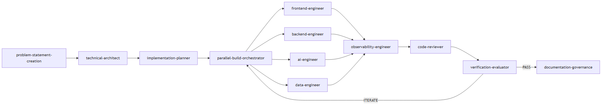
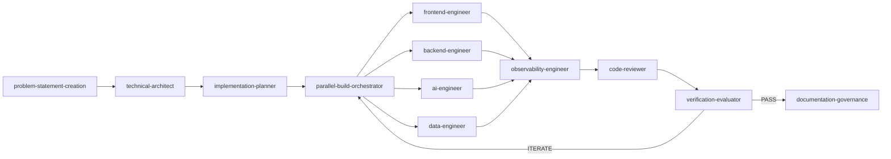

# The Agent Is Not the System: How to Build an AI Harness You Can Trust

*A practical architecture for turning probabilistic coding agents into a governed, testable, and continuously improving delivery system.*

## What We Are Building

We are building a repository-native **coding agent harness** that takes a software idea from problem statement to verified code.  
Specialized agents own architecture, planning, implementation, review, evaluation, and documentation.  
Human approval gates protect consequential decisions, while contracts let implementation agents work safely in parallel.  
A bounded evaluator loop verifies quality, returns focused corrections, and captures approved lessons for future runs.

The result is not another coding model. It is the engineering control system around the model.

## Demo: The Coding Agent Harness in Action

Use one small feature or application as the thread through the demo. Begin with a short project request, then show how the harness turns that request into evidence at every stage.

| Demo moment | What to show | What the audience should notice |
| --- | --- | --- |
| 1. Intent becomes an artifact | The request and generated `PROBLEMSTATEMENT.md` | Facts, assumptions, constraints, and open questions are separated before solutioning begins. |
| 2. Decisions require approval | `DESIGN.md`, `TechnicalGaps.md`, and the design approval state | The agent does not silently guess architecture, security, cost, or operational decisions. |
| 3. Work becomes executable | `IMPLEMENTATIONPLAN.md`, acceptance rubric, file ownership, and contracts | Every lane knows what it owns, how it integrates, and what will prove completion. |
| 4. Agents build in parallel | Frontend, backend, AI, and data lanes on the activity board | Agents change disjoint files and coordinate through stable contracts. |
| 5. Evaluation drives correction | One `ITERATE` result and its feedback artifact | The evaluator returns criterion-level findings to the owning lane instead of requesting a broad rewrite. |
| 6. The loop stops | Passing tests, final score, `PASS`, and the build report | Completion is based on evidence and an explicit stop condition, not the builder's confidence. |
| 7. The next run learns | A candidate memory record, human promotion, and later recall | Learning is evidence-backed, scoped, reviewable, and kept under a context budget. |

> **Insert your end-to-end demo here**  
> A 3–5 minute recording works well: project request → artifacts → approvals → parallel build → `ITERATE` → correction → `PASS`. Use shorter clips or screenshots for stages that take too long to run live.

The demo should emphasize the controls, not how quickly code appears. The useful questions are: who made each decision, which evidence moved the workflow forward, what caused iteration, and why was the system allowed to stop?

## A Harness Is Not Another Agent Framework

An agent framework helps an application call models, tools, and other agents. An engineering harness governs how agents change a software system.

That distinction matters. A harness does not need a new foundation model or a complicated runtime. It can be repository-native: Markdown specifications, versioned instructions, structured artifacts, deterministic scripts, tests, and a small set of specialized agents invoked from the development environment.

The simplest mental model is:

$$
\text{Agent Harness} = \text{Roles} + \text{Context} + \text{Contracts} + \text{Gates} + \text{Evaluation} + \text{Learning}
$$

Each term controls a different source of risk.

| Control | Question it answers |
| --- | --- |
| Roles | Who is allowed to make this decision or change? |
| Context | What evidence and instructions should the agent see? |
| Contracts | How do independent workstreams integrate? |
| Gates | Which decisions require a human? |
| Evaluation | What proves that the result is acceptable? |
| Learning | What should future runs reuse? |

The goal is not maximum autonomy. The goal is **bounded autonomy**: agents can move quickly inside explicit engineering constraints, while humans retain control over consequential decisions.

## The Reference Pipeline

The harness in this repository follows a software-delivery sequence:



<details><summary>Diagram source (Mermaid)</summary>



</details>

The workflow has six stages.

### 1. Turn the request into a fact base

The first agent writes a strict problem statement. It separates known facts, users, constraints, success measures, and unresolved questions from proposed solutions.

This prevents a common failure mode: an agent making an early implementation choice and then treating that choice as a requirement throughout the rest of the build.

The output should be a durable artifact such as `PROBLEMSTATEMENT.md`, not context that exists only in chat history.

### 2. Make architecture explicit

A technical architect converts the approved problem into a design and a visible list of technical gaps. The design records components, interfaces, data boundaries, security, observability, failure modes, and tradeoffs.

Unknowns should remain unknown. A visible `TODO: Add details` or a blocking item in `TechnicalGaps.md` is safer than a confident guess embedded in generated code.

The design is also the first important human gate. Architecture can be agent-assisted, but decisions with cost, security, compliance, or operational consequences should be approved before implementation begins.

### 3. Convert design into an executable plan

The implementation plan is more than a backlog. It should include:

- dependency-ordered tasks;
- expected file ownership;
- interface contracts;
- test expectations;
- a weighted acceptance rubric;
- explicit completion criteria.

This artifact turns “build the design” into work that generators and evaluators can independently interpret. The plan is the second blocking approval gate: once code generation starts, changing the plan becomes expensive.

### 4. Fan out by ownership, not by enthusiasm

Large builds can be split into frontend, backend, AI, and data lanes. Parallelism works only when each lane owns disjoint files and integrates through explicit contracts.

A useful invariant is:

$$
\forall f \in \text{changed files},\quad \left|\text{owners}(f)\right| = 1
$$

In plain language: every changed file has exactly one owning lane.

Agents should code against shared API, schema, event, and type contracts rather than reading and modifying each other's unfinished implementation. This reduces merge conflicts and limits the context each agent must load.

For a small change, skip the orchestration. A single coding agent with focused instructions is cheaper and easier to reason about. A harness should add process only when the task's risk or parallelism justifies it.

### 5. Fan in through one quality gate

After implementation, a reviewer and evaluator inspect the integrated result. The evaluator scores the build against the acceptance rubric and returns one of two outcomes:

- `ITERATE`: return specific findings to the owning lane;
- `PASS`: stop generation and produce the final evidence.

The feedback must be actionable. “Improve code quality” is not a useful loop instruction. “The backend lane must reject expired tokens in `POST /sessions`; add the missing test from acceptance criterion AC-07” is.

The loop must also be bounded. This harness uses regression detection, plateau detection, and an iteration budget. If quality stops improving, the system escalates to a human instead of consuming context indefinitely.

### 6. Capture evidence, then learn carefully

A successful run can produce reusable lessons: a recurring test requirement, a repository convention, a deployment constraint, or a pattern that prevented a defect.

Do not append every observation to one giant prompt. That creates conflicting instructions, stale rules, and a growing token tax.

Instead, use a governed memory lifecycle:

1. Capture a candidate with evidence and scope.
2. Resolve duplicates and conflicts.
3. Require human approval for durable promotion.
4. Rank and cap recalled rules.
5. Expire or evict stale guidance.
6. Materialize only relevant lessons into agent context.

This makes memory versioned, reviewable, and reversible. The purpose of learning is not to remember everything; it is to reduce rediscovery without hiding why a rule exists.

## How to Build Your Own Harness

You do not need to begin with a dozen agents. Build the smallest system that closes the engineering loop, prove that it improves delivery, and add complexity only when the evidence justifies it. The following seven steps provide a practical implementation order.

### Step 1: Define three roles

Begin with:

1. **Planner**: turns intent into an approved plan with acceptance criteria.
2. **Builder**: implements one scoped task and runs focused checks.
3. **Evaluator**: independently verifies the result and returns `ITERATE` or `PASS`.

Keep role specifications narrow. For each role, define its inputs, allowed tools, files it may change, required outputs, and conditions under which it must stop or escalate.

Separation matters because a builder is naturally biased toward accepting its own implementation. Independent evaluation creates useful tension between generation and proof.

### Step 2: Make artifacts the handoff mechanism

Chat history is transient and difficult to audit. Pipeline artifacts should be files with stable names and schemas.

A practical starting set is:

```text
output/
  PROBLEMSTATEMENT.md
  DESIGN.md
  TechnicalGaps.md
  IMPLEMENTATIONPLAN.md

feedback/
  feedback-001.md
  build-report.md

contracts/
  api.yaml
  events.schema.json
```

The exact names are less important than the rule: each stage reads defined inputs and produces defined outputs. A downstream agent should not need to reconstruct a decision from a long conversation.

### Step 3: Separate agent, skill, and instruction

These three concepts are easy to collapse into one oversized prompt.

- An **agent** owns a role and decision boundary.
- A **skill** defines a reusable workflow such as TDD, code review, or verification.
- An **instruction** is a durable rule that applies by repository path or context.

For example, a backend agent may invoke a TDD skill while automatically receiving security instructions for files under `src/api/**`. This composition keeps role definitions readable and lets multiple agents reuse the same engineering standard.

### Step 4: Design the evaluator before scaling generation

The evaluator is the most important component in the harness. Without a credible definition of `PASS`, adding more generators only produces code faster.

Use two layers of evaluation:

**Deterministic checks** should cover what tools can prove: compilation, linting, type checking, executable tests, coverage thresholds, duplication, dependency policy, and security scans.

**Rubric-based evaluation** should cover task-specific behavior: acceptance criteria, architecture alignment, operability, accessibility, and required documentation.

Protect test integrity explicitly. Deleting, skipping, or weakening a test to reach `PASS` should be a blocker, not an optimization.

### Step 5: Add approval gates where errors compound

Not every action needs confirmation. Put human gates before decisions that are costly to reverse:

- problem scope;
- architecture and service choices;
- implementation plan and acceptance rubric;
- infrastructure execution;
- destructive operations;
- promotion of learned rules.

Avoid placing gates around routine reads, local focused tests, or reversible edits. Too many approvals turn a harness into a notification system; too few turn it into an unsupervised experiment.

### Step 6: Add parallel lanes only after contracts exist

Parallel agents increase throughput, but they also multiply integration risk. Before adding lanes, define:

- one owner per file;
- stable contracts between lanes;
- a shared definition of done;
- a fan-in integration step;
- one final verification pass.

Independent lanes often produce local duplication or inconsistent abstractions even when every lane passes its own tests. Plan a consolidation review after fan-in.

### Step 7: Measure quality and cost together

Do not evaluate a harness only by whether it eventually produced working code. Track:

- quality score;
- iterations to `PASS`;
- elapsed time;
- tool calls;
- uncached token consumption;
- human interventions;
- regressions introduced;
- acceptance criteria completed.

A useful directional measure is:

$$
\text{Efficiency} = \frac{\text{Verified quality}}{\text{Consumption} \times \text{Iterations}}
$$

The equation is not a universal benchmark. It is a reminder that a more elaborate harness is not automatically a better one.

The repository's [documented benchmark comparison](harness-engineering-demo-script.md) showed why this measurement matters. The full unoptimized harness explored more and cost more than the bare prompt. After targeted repository memory was introduced, tool calls fell from 83 to 52 and approximate assistant output tokens fell from 62.3K to 49.0K, while the deterministic code-quality score reached 9.02 versus the bare run's 6.64. These output-token figures exclude input, cache processing, tool payloads, and server-side memory recall, so they are directional rather than billing totals. The lesson was not “orchestration saves tokens.” It was “orchestration must earn its cost through measurable quality and reduced rework.”

## What to Keep in Mind When Building Your Harness

The hardest part is not creating more agents. It is deciding where autonomy begins and ends, how agents exchange state, what evidence is trusted, and how much process each task deserves. Keep the following failure modes visible during design and review.

### The mega-agent

One agent is asked to discover requirements, choose architecture, write every layer, review itself, and declare success. It may work on small tasks, but its decisions are difficult to inspect and its self-evaluation is weak.

**Better:** separate planning, generation, and evaluation at minimum.

### Prompt accumulation

Every failure becomes another permanent instruction. Eventually the context contains stale, overlapping, or contradictory rules.

**Better:** store evidence-backed memory records with scope, ranking, conflict resolution, and expiry.

### Parallelism without ownership

Several agents modify shared files or invent incompatible interfaces. Time saved during generation is lost during integration.

**Better:** assign one file owner and publish contracts before fan-out.

### Evaluation by vibes

The system accepts a build because the output looks plausible or the agent says the tests pass.

**Better:** execute deterministic checks and preserve their evidence. Use model judgment only where deterministic tools cannot decide.

### Endless correction loops

The evaluator repeatedly returns broad feedback, and the builder repeatedly rewrites large areas.

**Better:** use criterion-level findings, route them to owners, detect regression and plateaus, and enforce an iteration budget.

### Harnessing every task

A tiny bug fix is forced through the same process as a new distributed system.

**Better:** define operating modes. Use a focused single-agent path for narrow changes and the full pipeline for high-risk or multi-domain work.

## What Good Looks Like

A mature harness makes the state of engineering visible.

At any point, a developer should be able to answer:

- What stage is running?
- Which artifact is the current source of truth?
- Which decisions are approved?
- Which agent owns each change?
- What evidence caused the latest failure?
- How many iterations remain?
- What exactly caused `PASS`?
- Which lesson, if any, will be reused next time?

That visibility changes the conversation. Instead of asking, “Did the agent write the code?” teams can ask, “What evidence shows this change is ready?”

## Start Small, but Close the Loop

The first version of your harness can be simple:

1. Store the request and acceptance criteria in a versioned plan.
2. Give one builder a narrow file scope.
3. Run deterministic verification.
4. Ask an independent evaluator for `ITERATE` or `PASS`.
5. Stop after a fixed number of attempts and escalate.
6. Record one evidence-backed lesson from the result.

That is already a harness. Specialized architecture agents, parallel lanes, dashboards, benchmark suites, and curated memory can be added when the simpler loop exposes a real need.

The central idea is straightforward: **do not try to make the model deterministic; make the system around it disciplined.**

AI agents will continue to become faster and more capable. That makes the harness more important, not less. When generation is cheap, the differentiator is the engineering system that can govern intent, prove quality, stop responsibly, and improve without forgetting why.

The useful question is no longer, “Can an agent write this code?”

It is: **“What system lets us trust, improve, and economically scale the work?”**

---

*This article is based on the repository-native AI Coding Agent Harness described in this project. Before publishing, replace the demo callouts with your recordings and add links to any public repository, benchmark methodology, or sample artifacts you want readers to explore.*